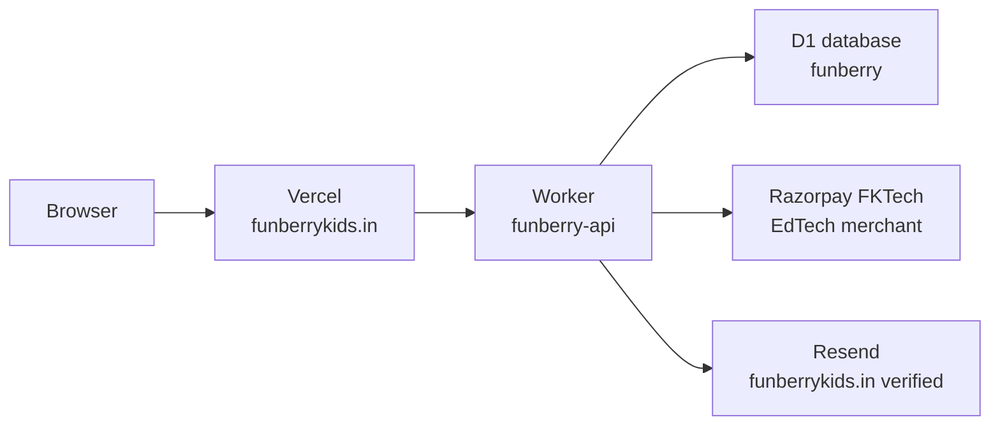

# FunBerry Kids — architecture guide

Written 12 October 2026 so a different AI on a different computer can work without this chat.

Read this file, then `AGENTS.md`. `AGENTS.md` is the editing contract (what not to claim, where prices live, how stars and PIN work). This file is the map of the running system.

## What it is

FunBerry Kids is a learning-games site for children about 5–8, aligned with ICSE Class 2 EVS, plus a Computer Studies world. Parents create an account, add child profiles, and children play short games. Live brand: **FunBerry Kids**. Support: `hello@funberrykids.in`.

It is not Okavo and it is not Data For Dummies.

## Live addresses

| Surface | Address | Status on 13 Oct 2026 |
|---------|---------|------------------------|
| Website (www) | https://www.funberrykids.in | HTTP 200. |
| Apex domain | https://funberrykids.in | HTTP 200. DNS `A` is still `76.76.21.21`. |
| Vercel default | https://funberry-web.vercel.app | HTTP 200. Same app. |
| GitHub | https://github.com/fkhambaty/funberry | Source of truth. |

`www` is a CNAME to `cname.vercel-dns.com`. Apex and www both answered on 13 Oct 2026, so DNS was left unchanged.

GoDaddy reported on 14 October 2026 that `funberrykids.in` expires **31 March 2029** and automatic renewal is **off**. The site does not survive that date unless the owner renews it or explicitly enables auto-renew in GoDaddy. This is an account/billing action, not a code deployment.

### Shared D1 quota dependency

All D1 databases in Cloudflare account `ec00d4a6131c20118d82605d6b969c8e` share the free-tier daily limits. On 14 October 2026 an unrelated `customjobseek` database used 167,866 row writes, exhausting the account's 100,000 free daily row-write allowance even though FunBerry used only 6. Account, session and progress writes then failed until Cloudflare's 00:00 UTC reset. The Worker detects this exact condition and returns a truthful retryable HTTP 503 instead of a generic 500; it cannot restore writes.

This can recur every day while that workload remains in the same free account. The durable remedies are to upgrade the Cloudflare account to Workers Paid or isolate/stop the unrelated workload. Do not modify `customjobseek` from this repository. Cloudflare documents the shared daily allowance and reset at https://developers.cloudflare.com/d1/platform/pricing/ and https://developers.cloudflare.com/d1/platform/limits/.

The owner explicitly declined a billing-plan change on 14 October 2026. Therefore daily write outages remain an accepted external risk until that decision changes.

## How a request moves



Marketing pages are server-rendered. `/play` and `/dashboard` are client-heavy. Accounts, children, stars, packs, coupons, and admin data live in D1 database `funberry` (`e0bf4f89-c29d-4c0d-9674-b5977847e7d1`). Razorpay subscriptions use the FKTech EdTech merchant, shared only with Data For Dummies. Okavo is not on this merchant.

Mobile (`apps/mobile`, Expo) signs in against this Worker, stores the session in the device keychain, and can play. Simple games run natively. Motion and Pixi games run in an allowlisted WebView on `/embed/game/<id>`, with a one-time play ticket instead of the parent session. The website is still the primary surface. The app does not sell a subscription. Read `apps/mobile/docs/MOBILE_ARCHITECTURE.md` and `apps/mobile/docs/MOBILE_RELEASE.md`. Play tickets need `cloudflare/d1/005_play_tickets.sql` applied before that Worker route is deployed.

## Repository map

```
apps/web                 Next.js site. Vercel builds this workspace.
apps/mobile              Expo app. Parent tools, native simple games, WebView for the rest.
packages/config          Brand, zones, prices. Change the name only in brand.ts.
packages/game-engine     Game templates and EVS content. Loaded on demand.
packages/supabase        Account client. Talks to the Cloudflare worker, not Supabase.
cloudflare/worker        FunBerry account API.
cloudflare/d1            SQLite schema for that API.
packages/ui              Shared components.
supabase/migrations      Postgres, RLS, RPCs. Shipping SQL in git does nothing until it is applied.
docs/                    Learning packs, syllabus alignment, computer exam world.
```

Zones children see come from `packages/config`. Games they play come from `packages/game-engine`. The Supabase `zones` and `games` tables are seeded and are not what `/play` reads.

## Routes

| Who | Path |
|-----|------|
| Anyone | `/`, `/pricing`, `/privacy`, `/terms` |
| Parent | `/login`, `/signup`, `/dashboard`, `/dashboard/progress`, `/dashboard/packs` |
| Child | `/play` |
| Owner | `/admin` (owner emails only) |
| Worker | `/v1/payments/razorpay/subscription`, `/confirm`, `/cancel`, `/v1/payments/razorpay/webhook`, `/v1/coupons/redeem`, `/v1/admin/*` |

Stripe route stubs exist and are not the live payment path. Live web payments are Razorpay, in INR, on the worker.

## Data and auth

Accounts, children, stars, unlocks, rewards, learning-pack text, and coaching reports live in Cloudflare D1 database `funberry` (`e0bf4f89-c29d-4c0d-9674-b5977847e7d1`). The browser calls `https://funberry-api.fkhambaty.workers.dev`. The session token is stored in the browser. Passwords are hashed. The worker checks that a parent only reads their own children.

Signup emails a 6-digit code. The parent cannot sign in until web `/signup` or the Expo signup screen accepts that code. The mobile callback route only explains that old confirmation links are retired; it never accepts tokens from a URL. `/forgot-password` emails a reset code. Codes expire after 15 minutes and allow 5 tries. Email goes through Resend: worker secret `RESEND_API_KEY`, sender `MAIL_FROM` in `cloudflare/worker/wrangler.toml`. Without the secret, signup and reset return 503 on purpose.

The browser may only call servers listed in `connect-src` in `apps/web/vercel.json`. The worker address must stay in that list or every login fails.

Test login: username `dummy`, password `dummy`, parent PIN `1234`, one child "Test Kid". It is an ordinary parent account and is not on the admin list. The account stays on lifetime access. Choosing Weekly or Monthly on the dashboard returns before Razorpay and shows “Demo account: no charge”. The worker answers the same phrase with HTTP 403 if a charge is requested anyway. There is no separate payment-return route: a finished checkout reloads `/dashboard` and the page reads `sessionStorage` key `funberry_pending_sub`.

The parent PIN is checked on the worker. Responses include `pin_set` and do not include the PIN. An older plaintext value is hashed the next time that parent is loaded, then the plaintext column is cleared. Do not log it.

Old Supabase project ref `tkuakihsswzhrcrqcqel` is no longer the account database. Do not point new login, coupon, admin, or payment code back at it. The website does not call that host.

Zones children see come from `packages/config`. Games they play come from `packages/game-engine`. There is no zones or games table in D1.

## Payments

FunBerry Kids and Data For Dummies share the FKTech EdTech Razorpay account. Okavo is a marketplace and requires a separate merchant account. FunBerry only acts on subscriptions whose notes say `product: funberry`. Plan ids and the publishable key id are worker vars. The key secret and the FunBerry webhook secret are worker secrets. Prices live in `packages/config/src/pricing.ts`. The browser must not say "charge this many rupees."

1. A signed-in parent asks the worker for `weekly` (52 cycles, ₹99) or `monthly` (12 cycles, ₹349). The worker reuses a still-`created` subscription for that parent and plan from the last 15 minutes. It refuses when premium is already active, and the dummy account never reaches Razorpay.
2. Checkout.js opens with `name: FKTech` so the payer sees FKTech. The description says FunBerry Kids Premium and the price. If Razorpay reports a website mismatch, the parent is sent to that subscription's hosted `short_url`. Coming back to the dashboard makes the worker re-read the subscription and grant premium only when Razorpay says `active` or `authenticated` and the subscription belongs to that parent.
3. The confirm call checks `HMAC_SHA256(key_secret, payment_id + '|' + subscription_id)` before that grant. It is safe to repeat.
4. When `/v1/parent` sees a stored Razorpay subscription whose expiry has passed, it fetches the subscription again and either extends premium or sets the account back to free for `cancelled`, `halted`, `completed`, or `expired`.
5. Parents can turn off auto-renew from the dashboard. That calls Razorpay cancel with `cancel_at_cycle_end: 1`. Premium stays until the period already paid.
6. `POST /v1/payments/razorpay/webhook` is a backup. Register `https://funberry-api.fkhambaty.workers.dev/v1/payments/razorpay/webhook` in the Razorpay dashboard for this FunBerry webhook secret, with events `subscription.activated`, `subscription.charged`, `subscription.cancelled`, `subscription.halted`, and `subscription.completed`. Delivery is ignored when the event id was already stored.

Coupons and `/admin` also live on the worker. Owner emails `fakhruddinkhambaty@gmail.com` and `fktiindia@gmail.com` are promoted to admin when they sign up, verify, or sign in. Coupon codes grant premium days, with an optional expiry, a redemption cap, and one redemption per account.

## Local run

```bash
npm install
cp apps/web/.env.example apps/web/.env.local
npm run dev:web          # http://localhost:3000
npm run dev:mobile       # Expo, signed in against the same Worker
npm run typecheck
npm run check --workspace=@funberry/mobile
npm run build --workspace=@funberry/web
npx playwright install chromium
npm run test:responsive
```

`test:responsive` starts the already-built site on port 3000. Build the web app first. The suite signs in as `dummy` / `dummy`, then checks public pages, protected redirects, the parent PIN, the dashboard coupon and dummy checkout, the child picker, and one game of every template. `e2e/a11y.spec.ts` runs axe on each of those game templates.

GitHub Actions runs typecheck, the web build, worker tests, lesson tests, and that Playwright suite on every push and pull request. A separate `mobile` job lints, typechecks and unit-tests the Expo app. It does not build an APK or an iOS app. A weekly workflow checks the live homepage, `/v1/health` (email readiness without creating an account), dummy login, a payment call that must answer “Demo account: no charge”, and phone plus desktop overflow. Apply `cloudflare/d1/004_integrity.sql` on the remote D1 database before deploying a worker that expects the PIN hash and event tables. Apply `cloudflare/d1/005_play_tickets.sql` before deploying a worker that issues play tickets. Neither migration was applied from this change.

Never commit `.env`, `.env.local`, or a service-role key.

## Design system

The look is a berry-and-sky meadow with tactile press controls, sized for ages 5–8. Change the palette in one place and let the surfaces inherit it.

| Piece | Where | What it owns |
|-------|--------|----------------|
| Color ramps | `packages/config/src/colors.ts` | Berry, leaf, sky, sunshine, ink, cream, paper. Brand hex values live here. |
| Tailwind names | `apps/web/tailwind.config.ts` | The same ramps as utility classes (`bg-berry-500`, `text-ink-700`, `min-h-tap`). |
| Tokens and chrome | `apps/web/app/globals.css` | CSS variables, focus rings, reduced motion, page washes (`.fb-app`, `.fb-marketing`, `.fb-auth`, `.fb-parent`, `.fb-kid-who`, `.fb-kid-world`, `.fb-admin`), tactile buttons (`.fb-cta`, `.kid-glass-btn`), cards (`.glass-card`, `.fb-plan`, `.fb-modal`), fields (`.fb-field`), and the game frame (`.fb-play-canvas`, `.fb-track`). |
| Shared controls | `packages/ui/src` | `KidButton`, `KidCard`, `KidModal`, `ZoneCard`, `GameResultScreen`, `ProgressBar`, `StarRating`, `ParentalGate`, `AvatarPicker`, plus presentational `AuthStage`, `Notice`, and `TextField`. These do not own account state. |
| Game chrome | `packages/game-engine/src/components/GameShell.tsx` | Header, star chip, progress track, and the shared play frame around every template. Templates keep their own logic and load through `loadGameTemplate()`. |

Full-height pages set `min-height: 100vh` and then `min-height: 100dvh`, so older browsers keep a height and mobile browser chrome does not cover the bottom. The game shell is the scrollport: `height` and `min-height` use that same pair, `overflow-x: hidden`, and `overflow-y: auto`. Bubble Pop, Star Catcher, and Pixi arenas stay `overflow: hidden` on purpose. Their height is `min(px, dvh)` so the canvas fits the visible screen and the shell can still scroll the rest.

Kid controls stay at least 48px. Home and other primary kid actions aim for 64px (`--tap-min`, `--tap-kid`). Headers pad for `safe-area-inset-*`.

Responsive smoke tests live in `e2e/` and `playwright.config.ts`. Viewports are `390x667`, `390x844`, `393x852`, `768x1024`, `820x1180`, `1024x768`, and `1440x900` (`e2e/viewports.ts`). Touch interactions run on `390x844`, `768x1024`, `1024x768`, and `1440x900`. One live game per template is listed in `e2e/template-catalog.ts`, including `aboutme-spot-senses` for spot-the-difference.

Rules for a visual edit:

- Keep the mascot and the berry/sky/leaf/sunshine palette. Do not introduce a second brand color as the primary.
- Kid tap targets stay at least 48px, and primary kid actions aim for 64px. Focus rings stay visible. `prefers-reduced-motion` already collapses animation.
- Do not move PIN checks, timers, star writes, pack generation, premium gates, or Razorpay into a presentation component.
- Parent copy can be precise. Kid copy stays short and kind. Do not add user counts, school logos, or claims about Stripe, offline play, or an AI that writes lessons.

## What not to get wrong

- Do not invent user counts, school logos, or city claims.
- Do not market Stripe, offline mode, or an AI that writes lessons. Learning Packs use OCR plus rules, not a lesson-writing model. Page photos are not stored. Read `docs/LEARNING_PACKS.md` before changing that pipeline. The Expo app can play games; it is not the primary surface and it is not in an app store. Those claims wait on `docs/EVIDENCE_GATES.md`. A dedicated Razorpay merchant name waits on the same file.
- The old Vercel cron that poked Supabase is gone. Accounts live on D1, so that ping had nothing left to keep awake.
- Resume headers and job-search files do not belong in this repo.

## If this computer is gone

`https://github.com/fkhambaty/funberry` is the copy that matters. It contains this guide, `AGENTS.md`, the Next.js app, the Worker, the D1 schema, and `cloudflare/worker/wrangler.toml`. Vercel rebuilds the website from that repository.

These names are Worker secrets and are not stored in Git: `RESEND_API_KEY`, `RAZORPAY_KEY_SECRET`, and `RAZORPAY_WEBHOOK_SECRET`. They remain in the Cloudflare Worker even if this laptop is lost. A local copy under `~/.config/fk-products/` is only a convenience and must never be committed. Public values that are safe in Git are the key id and the two plan ids in `wrangler.toml`.

The estate-wide handover (all three products, accounts, DNS, runbooks, history and diagrams) is the private repository https://github.com/fkhambaty/products-handover. Start there on a new computer.
