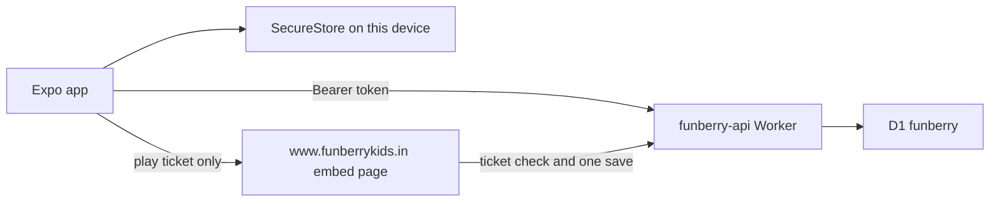
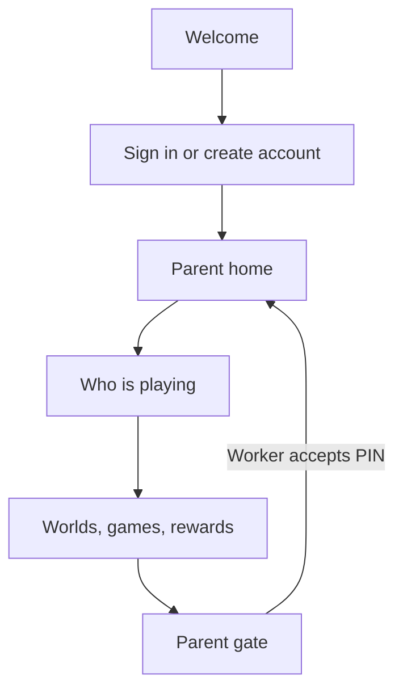
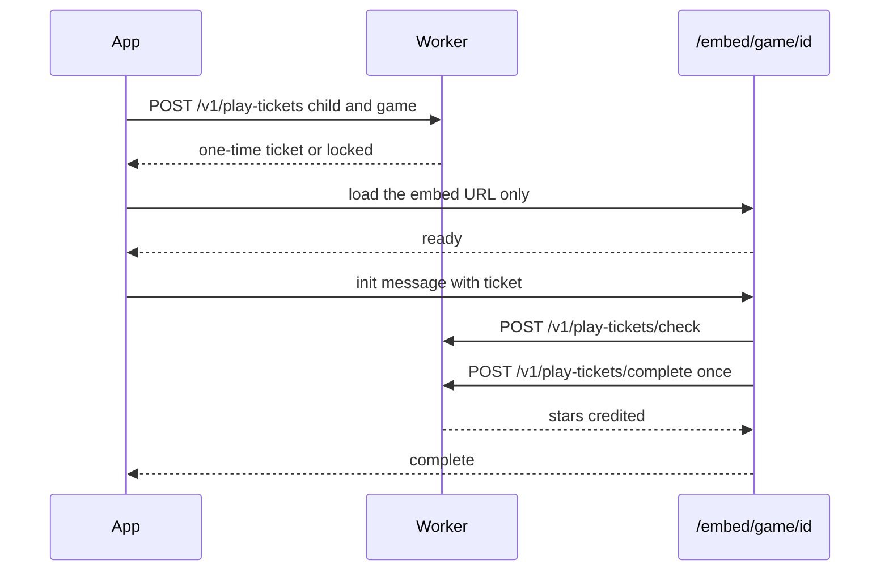

# FunBerry Kids mobile architecture

The Expo app in `apps/mobile` is a parent-and-child client for the same Cloudflare Worker the website uses. The website remains the primary surface. This app does not sell a subscription and does not claim offline play.

## How a session moves

The bearer token lives in the device keychain (`expo-secure-store`, `WHEN_UNLOCKED_THIS_DEVICE_ONLY`). It is not put in a URL, in AsyncStorage, or in the WebView. Logout deletes the server session and the local token.

Signup, the 6-digit email code, resend, forgot-password and reset-password call the same `/v1/*` routes as the website. The old `/auth/callback` screen explains that confirmation links are retired. It never reads a token from a URL.

## Parent and child mode

Child mode is stored in SecureStore. Closing the app does not skip the gate. A parent reaches parent screens only after `POST /v1/pin/verify` succeeds. That route compares a hash and locks for 15 minutes after repeated failures. The PIN is never shown again and never logged.

If the account has no PIN yet, the gate asks a short addition and tells the parent to set a PIN. That fallback is weaker than the hash check. Settings is where the PIN is set.

## What runs where

Simple tap games run in React Native. Motion, painting and Pixi games run on the website inside one WebView.

| Template | Where it runs |
|---|---|
| Picture quiz, true or false, odd one out, memory match, order it, sort it, word match, story | Native |
| Color activity, spot the difference, bubble pop, star catcher, Pixi lab | WebView |

Native rounds use `buildGameResult` from `@funberry/game-engine`, then `POST /v1/progress`. The Worker clamps stars to 3, credits only the improvement over the previous best, and refuses a game the child has not unlocked.

Sort-it on a phone is tap-an-item then tap-a-group. It uses the same categories and answers as the website's drag game. It does not pretend to be a physics game.

## WebView bridge

The ticket is 32 random bytes, stored only as a SHA-256 hash, bound to one parent, child and game, and it expires in 30 minutes. Completion marks it used, so a replay cannot add a second round. The page never receives the bearer token. The WebView allows only `https://www.funberrykids.in/embed/game/<this-id>`. Other navigations are blocked. Razorpay is not loaded there.

`cloudflare/d1/005_play_tickets.sql` must be applied before a Worker that serves `/v1/play-tickets` is deployed. Until then the website's existing progress route is unchanged, and the app's web games cannot save.

## Plans, data and children

The plan screen reads `subscription_tier` and the expiry already stored for the account. It shows Free, Premium Weekly, Premium Monthly, a legacy yearly value, or Lifetime, and says purchases are unavailable in this app. It does not show a price and does not link to checkout, the pricing page, or the parent dashboard. Privacy, terms, refunds and support stay in Settings. There is no RevenueCat, Stripe or Razorpay checkout in the binary.

Settings can export the account, delete it (the Worker phrase `DELETE MY ACCOUNT` plus the password), change the password, and open privacy, terms and refunds on the website. Export and delete use the existing Worker routes. The demo account cannot be deleted; the Worker enforces that.

Child profiles are created, edited and deleted through `/v1/children`. The app does not ask for a photo or the camera. Android camera, storage and location permissions are blocked in `app.json`.

Worlds and games come from `@funberry/config` and `@funberry/game-engine`. The app does not read a zones table. Computer Lab stays free. Other worlds open their free slice, then the rest with Premium, matching the website and the Worker's star check.

## Kids and families

Copy on a child screen does not mention billing, email or PIN digits. Targets are at least 48 points, and primary child actions are 64. Colors are the berry, sky, leaf and sunshine ramps from `packages/config/src/colors.ts`. The icon is the same Berry mark as the website.

Account data is the parent's. The app does not claim a school, a user count, offline play, or an AI that writes lessons. Learning Packs stay on the website.

## Not done here

Day-7 retention and free-to-paid have not been measured. The app is not submitted to the App Store or Play Store. In-app purchase receipt validation is not built. See `MOBILE_RELEASE.md` for the build gaps on this machine.
